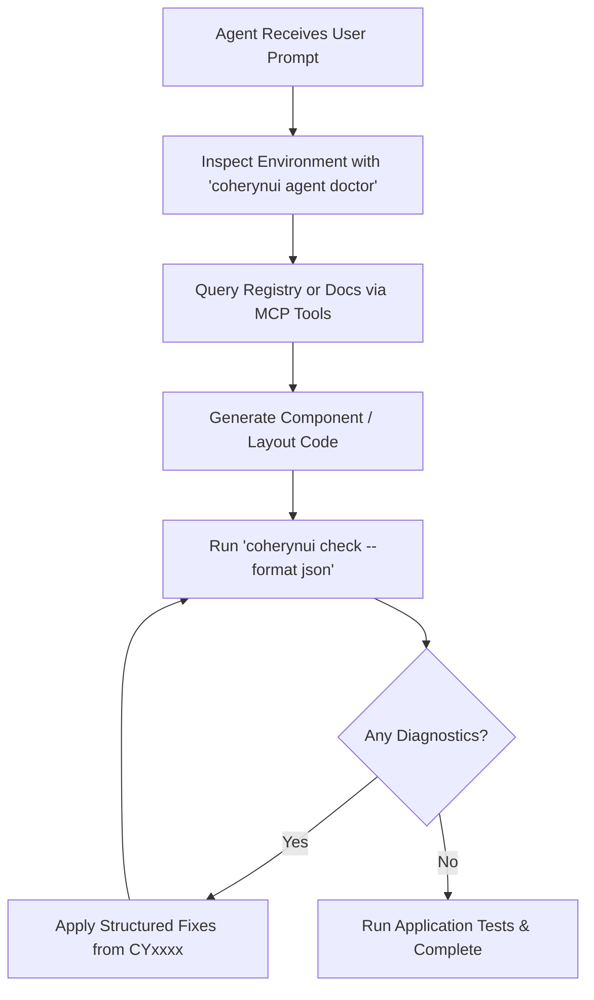

# CoherynUI — AI Coding Assistant & Agent Guide

**Authority:** [CoherynUI v1.3 Amendment (COH-AMD-1.3)](../../resources/Coheryn_UI_Amendment_v1.3.md)  
**Schema Version:** 1.0  

---

## 1. Core Principles for AI Assistants

When developing inside a CoherynUI codebase:
1. **Never Hallucinate Utilities**: CoherynUI uses canonical utility tokens. Unrecognized classes will be flagged as `CY1001` warnings by the compiler.
2. **Leverage Machine-Readable Metadata**: Query the MCP server or read `registry/index.json` to inspect component props, accessibility invariants, and dependencies.
3. **Always Validate Code Changes**: Run `coherynui check --format json` after code mutations. Parse the structured output to auto-correct any diagnostic errors.
4. **Respect Framework Agnosticism**: Pure CSS styling does not require runtime JavaScript. Do not add `@coheryn/coherynui-react`, `@coheryn/coherynui-motion`, or `@coheryn/coherynui-gpu-materials` unless interactive React components, physics springs, or WebGPU shaders are specifically requested.

---

## 2. CLI Agent Tooling

```bash
# Verify agent configuration, discoverable instructions, and skills
coherynui agent doctor

# Propose project instructions (AGENTS.md) without overwriting
coherynui agent init --dry-run
coherynui agent init

# List and install versioned skills
coherynui agent skills list
coherynui agent skills install --target-dir .agent/skills

# Run Model Context Protocol server over stdio
coherynui mcp serve
```

---

## 3. Recommended Workflow


